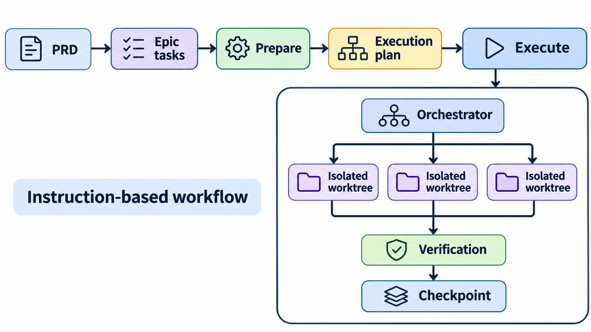
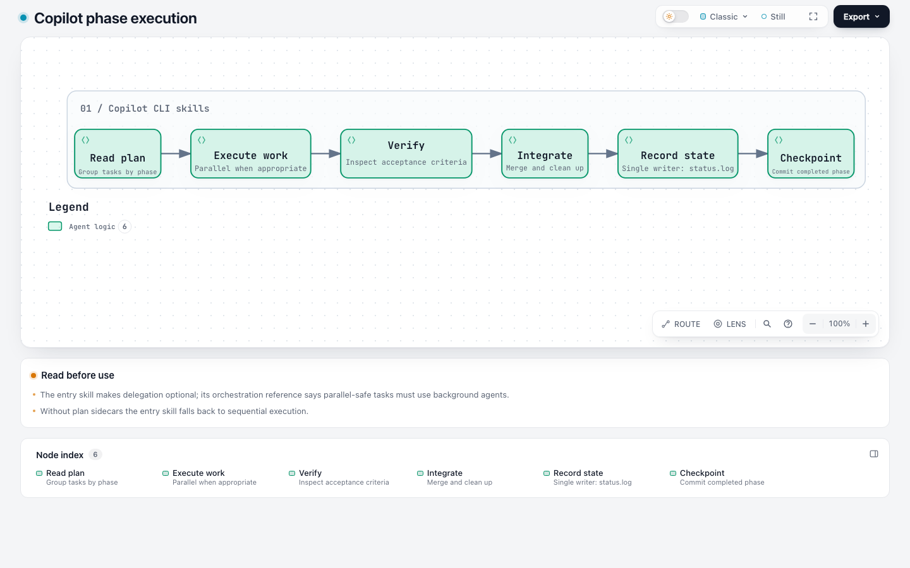

# Agent Teams Epic Pipeline Workflow

A collection of agent skill instructions for turning product requirements into epic task files, dependency-aware execution plans, and phased implementation. The repository includes a local-file workflow for **GitHub Copilot CLI** and a ClickUp-oriented workflow for **Claude Code**.



The image is a conceptual overview: parallel work is conditional, and the skills describe how an agent should behave. This repository is not a standalone orchestration engine, and the diagrams do not establish that a workflow has been run or verified.

## Explore the workflows

| | Copilot CLI | Claude Code |
|---|---|---|
| Skill instructions | [`.github/skills/`](.github/skills/) | [`.claude/skills/`](.claude/skills/) |
| Task state | Local Markdown and `status.log` | ClickUp tasks and comments |
| Parallel work | Subagents and Git worktrees for suitable phases | Agent teams and Git worktrees |
| Handoff | `finalize-epic` | External `push-epic-to-clickup` skill |
| Included entry points | Six `SKILL.md` files | PRD, epic, and analysis entry points; enrichment and execution reference files |

The tracked repository does **not** include a Codex adapter. The Claude workflow depends on ClickUp and contains project-specific agent names and conventions that need adaptation for another repository.

### Interactive diagrams

Open these standalone HTML files locally after cloning; each has source links pinned to the revision reviewed when it was created. GitHub does not render repository HTML as a live page directly.

- [PRD to epic execution](docs/diagrams/epic-pipeline.html) — the six Copilot stages and their handoffs.
- [Copilot phase execution](docs/diagrams/phase-execution.html) — planning, execution, verification, integration, state, and checkpoints.

[](docs/diagrams/phase-execution.html)

The editable Archify diagram specifications are alongside the HTML in [`docs/diagrams/`](docs/diagrams/). The illustration is AI-generated and is intended as a simplified overview; the source-linked diagrams and skills provide the details.

## Copilot CLI: local-file pipeline

The sequence specified by the tracked skills is:

1. [`seed-prd`](.github/skills/seed-prd/SKILL.md) researches the request and writes a structured PRD.
2. [`seed-epic`](.github/skills/seed-epic/SKILL.md) proposes epic boundaries, then writes task files after confirmation.
3. [`finalize-epic`](.github/skills/finalize-epic/SKILL.md) validates the epic, initializes `status.log`, updates its overview, and creates a checkpoint commit.
4. [`enrich-epic`](.github/skills/enrich-epic/SKILL.md) adds PRD and codebase context to the task specifications and creates a checkpoint commit when changes exist.
5. [`analyze-epic`](.github/skills/analyze-epic/SKILL.md) checks dependencies and conflicts, then writes per-task `.plan.md` files after confirmation.
6. [`run-epic`](.github/skills/run-epic/SKILL.md) presents the phase plan and, after confirmation, carries out tasks and checkpoints completed phases.

A typical epic folder has task specifications, corresponding plan sidecars, an `epic-overview.md`, and an append-only `status.log`. The instructions assign state updates and integration to the orchestrator; delegated workers report back. Status progresses from `open` to `in_progress` to `done`. If plan files are missing, the run skill specifies a conservative sequential fallback.

**Parallelism caveat:** the [run skill](.github/skills/run-epic/SKILL.md) describes delegation or `/fleet` as optional for parallel-safe phases, while its [orchestration protocol](.github/skills/run-epic/references/orchestration-protocol.md) instructs the agent to spawn background `task` agents for those phases. The reference also describes recovery options. Review and reconcile these instructions for your runtime before relying on parallel execution.

For example, make the skills available to Copilot CLI in the target repository and request the stages in order, using your own paths:

```text
seed-prd docs/my-feature
seed-epic docs/my-feature
finalize-epic docs/my-feature/epics/my-epic
enrich-epic docs/my-feature/epics/my-epic
analyze-epic docs/my-feature/epics/my-epic
run-epic docs/my-feature/epics/my-epic
```

These are skill invocation examples, not shell commands. Confirm how your installed Copilot CLI discovers and invokes repository skills before use. Finalization and enrichment instruct the agent to commit changes without an additional commit prompt; review the instructions and your working tree before running them.

## Claude Code: ClickUp-backed workflow

The documented path is PRD → epic task drafts → ClickUp handoff → enrichment → analysis → execution. The [Claude workflow walkthrough](ai_docs/workflow/epic-pipeline.md) describes the agent-team and ClickUp approach. Start with the tracked [`seed-prd`](.claude/skills/seed-prd/SKILL.md), [`seed-epic`](.claude/skills/seed-epic/SKILL.md), and [`analyze-epic`](.claude/skills/analyze-epic/SKILL.md) instructions.

The repository references an external `push-epic-to-clickup` skill, and includes references for enrichment and execution without their `SKILL.md` entry points. Those missing pieces must be supplied or adapted before the full Claude workflow can be invoked as described. The walkthrough includes environment-specific examples and should be reviewed before reuse.

**Review permissions before use:** [`.claude/settings.json`](.claude/settings.json) enables experimental agent teams, selects tmux, sets `defaultMode` to `bypassPermissions`, and skips the dangerous-mode prompt. Change these settings to match your environment and desired approval controls before using this configuration.

## Repository layout

```text
.github/skills/          Copilot CLI skill instructions and references
.claude/skills/          Claude Code skill instructions and references
.claude/settings.json    Claude configuration
ai_docs/workflow/        Claude workflow walkthrough
docs/diagrams/           Source-linked Archify diagrams and visual assets
```

These skills are prompts and protocols consumed by coding agents. Their actual behavior depends on the runtime, available tools, repository state, permissions, and the agent's execution. Review planned changes and validate results in the target project.
